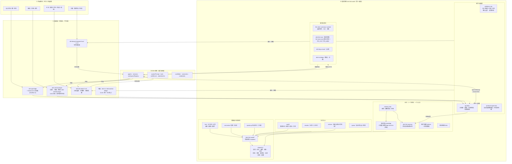
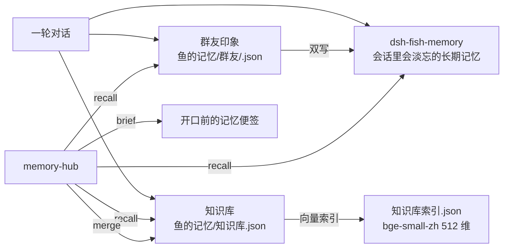

# 鱼的世界 · 全局架构

> 一张图看懂：谁在说话、谁在记事、谁只是「手」。
> 底线：**模型、人设、记忆、语气永远留在 DSH 侧；外部平台/插件只能当手，不能当嘴。**

## 1. 分层总览



## 2. 一条消息的六段路（本地是轴）

> 外部输出 → 本地接住 → 本地交给模型 → 模型回答 → 本地处理回复 → 外部收到回复
> 任何一步都不允许绕过本地：平台不能直接叫模型，模型也不能直接发平台。

| # | 阶段 | 谁做 | 关键动作 | 输出 |
|---|---|---|---|---|
| ① | 外部世界输出 | 微信 / QQ / B站 / 抖音 | 平台原样产生消息事件 | 原始事件 |
| ② | 本地接收并处理 | `qq-inbox` | 白名单过滤 → 按会话去重 → 攒批等他说完 → 展开引用/合并转发 → 图片落附件 → 视频抽帧 | 一批可投递消息（名单外直接丢，不记账） |
| ③ | 本地交给模型 | `deliverToSession` | `agent.followup(content, source.kind=平台)` | DSH 原生轮次（不伪造主人输入、不新建会话） |
| ④ | 模型回答 | DSH Agent | 人设 / 记忆召回 / 鱼的风格 / 授权内工具 | 这一轮要说的话（可为空 = 选择沉默） |
| ⑤ | 本地处理回复 | `onTurnEnd` | 去内部盘算 → 去拉黑句 → 拆气泡（≤5）→ 过闸门（每日额度/间隔/字数）→ 定位回哪个会话 | 真正要发的文本 |
| ⑥ | 外部世界收到回复 | `qq.send` → 平台桥 | 逐条发送；失败保留重试、连续失败留痕 | 用户在平台看到回复 |

失败时的口径：投递失败重试 3 次后留痕；额度不足直接说明、不偷发；模型不可用就等恢复、不编回复；图/视频处理失败时这条照投并写明原因。

对应实现：`lib/qq-inbox.mjs`（②⑤）· `lib/index.js` 的 `deliverToSession`（③）· DSH Agent（④）· `lib/qq.mjs` 的 `send`（⑥）。
示意图：`FLOW.svg` / `FLOW.png`。

## 3. 记忆的三处与一个衣柜



## 4. 四平台：谁当手、谁当嘴

| 平台 | 通道（手） | 谁生成回复（嘴） | 鱼世界的角色 |
|---|---|---|---|
| QQ | `dsh-qq-bridge` + SnowLuma (OneBot 11) | **DSH 里的鱼** | 闸门、收件、攒批、空间、审计 |
| 微信 | dsh-wechat-plugin（设置 → 微信；路由 `/.dsh-wechat-plugin`） | **DSH 里的鱼**（人格由本机配置快照校验） | 闸门、只读展示白名单/人格/限流、审计 |
| B 站 | `dsh-bili-whale`（扫码登录、生物钟、风控） | **DSH 里的鱼**（persona.md 可同步） | 平台卡、只读账号、细项直写 whale 配置 |
| 抖音 | `dsh-douyin-browser-local` | **DSH 里的鱼** | 平台卡、设置同步、闸门 |

> 禁止组合：同一个账号上跑两套会自动回话的机器人（例如 dsh-im 微信自带 agent）——那是「两个嘴」，会抢话、重复发言。

## 5. 数据落盘（都在工作区/DSH_HOME，不进仓库）

```text
<工作区>/鱼的世界/
├─ 鱼的日记/            日记（按天 jsonl）+ 批语/
├─ 鱼的请求/            请求（按天 jsonl，裁决写回）
├─ 鱼的成长/            成长账本 + 索引
├─ 鱼的记忆/            知识库.json · 知识库索引.json · 群友/<QQ>.json
├─ 鱼的状态/            心情（读 dsh-feiyu-mood）
├─ 鱼的关系/            people.json · chats.json
├─ 安全与审计/          时间线（按天 jsonl）
├─ 鱼之宝库/            图库 + stickers.json
└─ 网站链接/            links.json

<DSH_HOME>/
├─ fish-memory/         dsh-fish-memory 的会话记忆
├─ bili-whale.config.json
├─ bili-duty/           （旧 subagent，已停用）
└─ profiles/desktop/    插件装载清单（package.json / cordis.patch.yml）
```

## 6. 安全边界（硬约束）

- **默认拒绝**：所有外发（发消息、评论、点赞、发帖、分享）默认关，逐项打开。
- **写操作只认 loopback**：面板/接口的写路由校验来源地址；入站推送另需 token。
- **凭据不进仓库、不进日志、不进提示词**：单独落盘（0600），接口只回打码/布尔。
- **鱼箱沙箱**：鱼只能读写自己的工作区，绝对路径/盘符/`..`/符号链接一律拒绝。
- **只借手不借嘴**：AstrBot / QQ Agent / 第三方插件只提供工具执行结果，回复永远由鱼生成。
- **可逆优先**：停用插件写 `disabled: true` 并留备份；删除只删联接，不碰目标。

## 8. 「本地」到底是谁？——一致性核对

六段路成立，但「本地」指的是**本机 DSH 侧**，不总是鱼世界自己。按平台核对：

| 通道 | ②接收处理 | ③交给模型 | ⑤处理回复 | 是否过鱼世界闸门/审计 |
|---|---|---|---|---|
| QQ 白名单群 / 好友 | 鱼世界 `qq-inbox` | 鱼世界 | 鱼世界 `onTurnEnd` | ✅ 全程 |
| QQ 主人私聊 | 桥直接注入 | 鱼世界 | **桥自己发**（鱼世界只剥漏出的盘算） | ⚠️ 发送不过在鱼世界 |
| 微信（dsh-wechat-plugin） | 它自己收件 | 它注入 DSH 会话 | 它自己的策略与限流 | ❌ 鱼世界只读展示 |
| B 站 / 抖音 | 各自插件调度 | 鱼世界（DSH 回合） | 各自插件策略 + 鱼世界动作闸门 | ⚠️ 工具调用过闸门，插件自主动作不过 |
| AstrBot 入站 | 鱼世界 `deliverInbound` | 鱼世界 | 由 AstrBot 桥回发 | ⚠️ 入站过，出站不过 |

结论：
- **模型永远不直接碰平台**（只能通过本地工具，工具本身有闸门）——这一条成立。
- **不是每条消息都经过鱼世界**：QQ 主人私聊、微信、B 站/抖音的自主行为，由对应桥/插件完成 ②⑤。
- 要让某条通道「全程归鱼世界管」，只有两种做法：接管它的收件与发送（像 QQ 白名单那样），或只把它当传输层、禁用其自带 agent（例如不用 dsh-im 的微信）。


## 7. 可观测性（面板上能看见的）

- **整合范围（SCOPE 13 项）**：就位 / 缺闸 / 缺件 + 用量 + 缺什么怎么修。
- **时间线**：谁在什么时候动了什么（只记 id / 键名 / 开关，不抄值）。
- **体检**：依赖、接线、存储目录、索引一致性。
- **花费 / 主动开口 / 鱼的风格**：只读上游，不代改。
